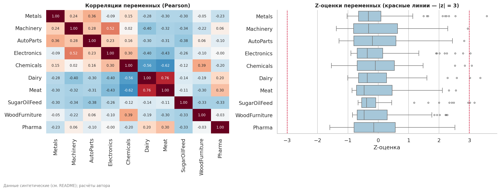
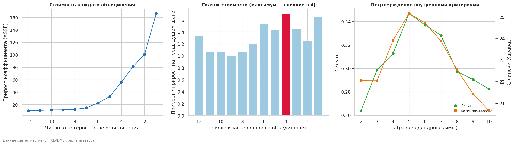
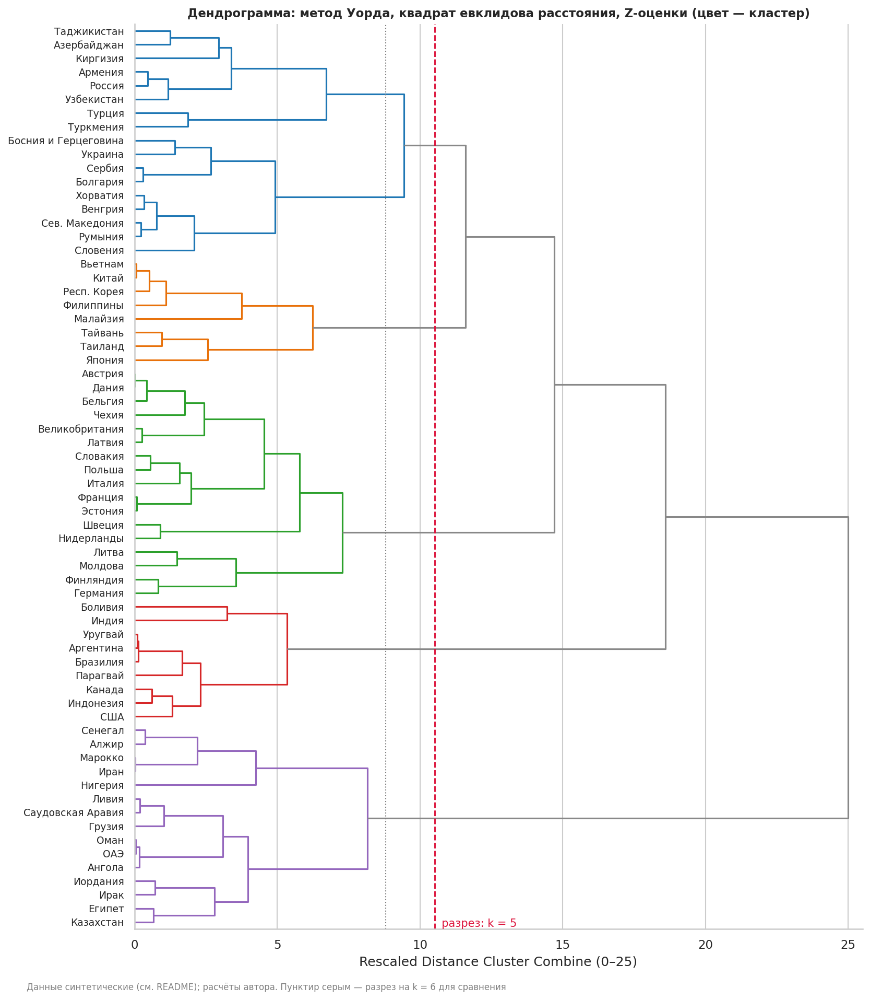
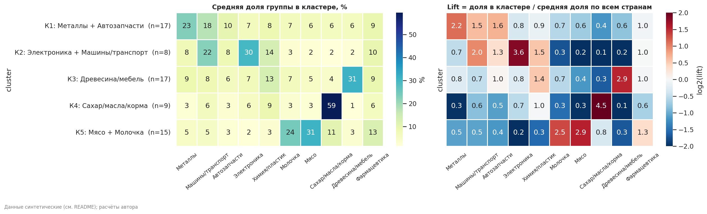
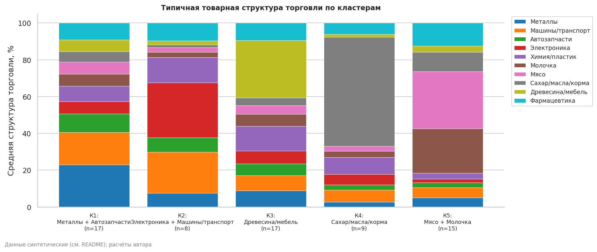
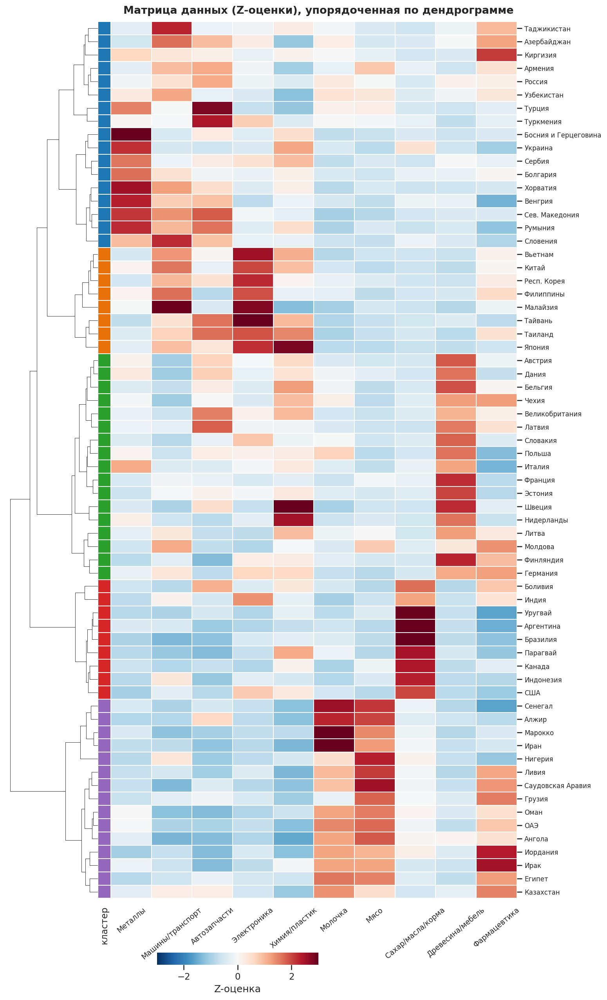
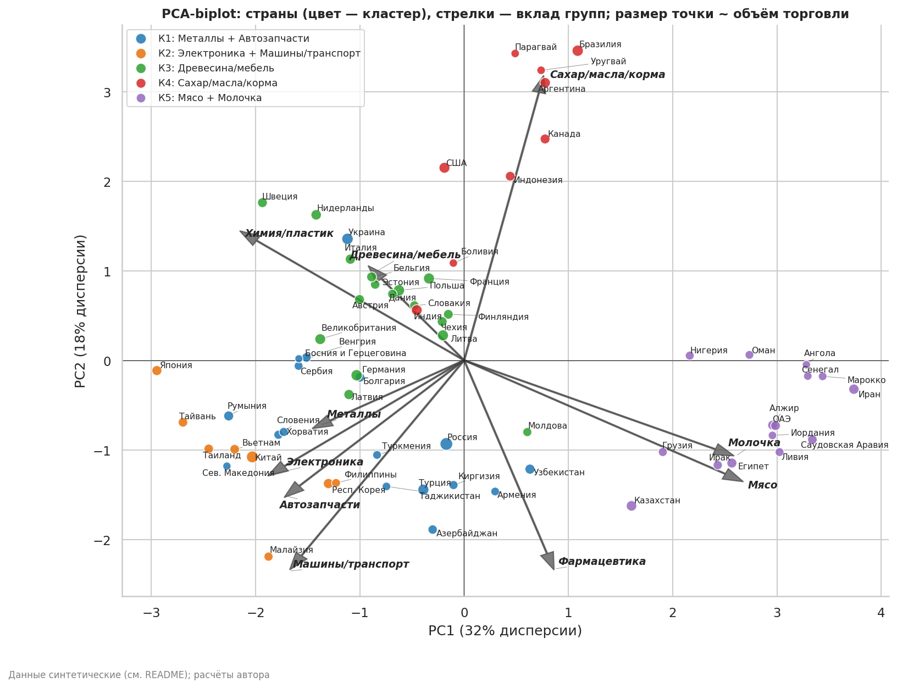
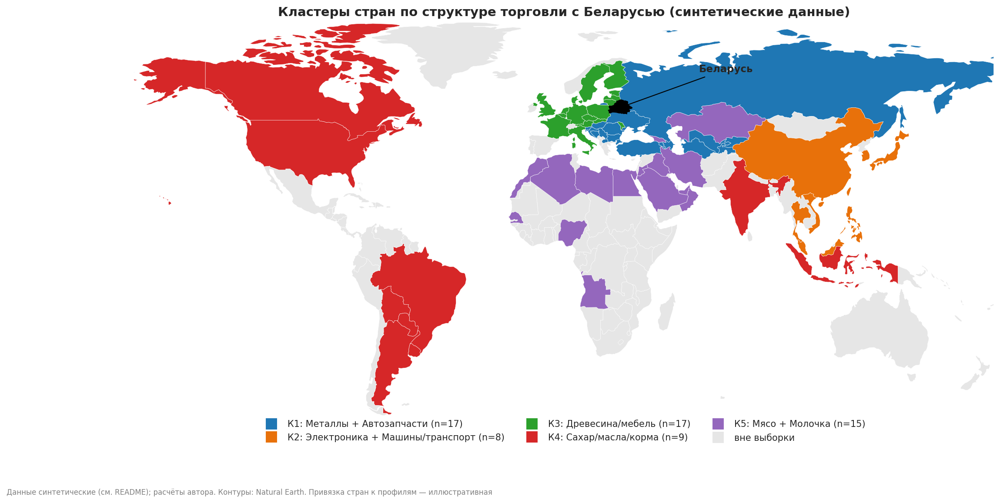
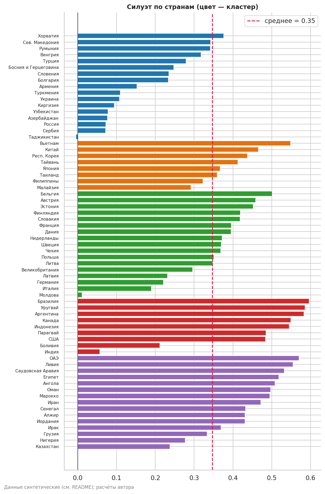

# Задание 3. Кластерный анализ стран-партнёров Беларуси (по логике SPSS)

Сегментация стран по структуре торговли: **иерархический кластерный анализ методом Уорда** со стандартизацией (Z-оценки) и квадратом евклидова расстояния — то есть так, как это делается в SPSS (*Analyze → Classify → Hierarchical Cluster*). Расчёты выполнены в Python; в папке `spss/` лежит `.sps`-синтаксис и в `data/` файлы `.sav`, чтобы повторить анализ в самом SPSS.

> ## ⚠️ Данные синтетические
> В файлах Белстата из Задания 1 нет разбивки по странам (только товары), поэтому реальную матрицу «страна × товарная группа» построить нельзя; задание допускает синтетику.
> - **10 товарных групп — реальные**: собраны из позиций Задания 1 (например, «Молочная продукция» = молоко + сгущённое молоко + масло + сыры).
> - **66 стран** и привязка к 6 «архетипам» торговой структуры — **иллюстративное допущение автора**; сами числа сгенерированы (Dirichlet-Multinomial: шум, нули, «смешанные» страны).
> - Поэтому **выводы описывают работу метода, а не реальную торговлю Беларуси**. На реальных данных тот же код запускается без изменений ([как](#как-подставить-реальные-данные)).

## Содержание

1. [Соответствие шагам SPSS](#соответствие-шагам-spss)
2. [Шаг 1. Данные: что за матрица](#шаг-1-данные-что-за-матрица)
3. [Шаг 2. Z-оценки и матрица расстояний](#шаг-2-z-оценки-и-матрица-расстояний)
4. [Шаг 3. Таблица агломерации](#шаг-3-таблица-агломерации-agglomeration-schedule)
5. [Шаг 4. Сколько кластеров — решение по дендрограмме](#шаг-4-сколько-кластеров--решение-по-дендрограмме)
6. [Шаг 5. Разбиение и профиль кластеров](#шаг-5-разбиение-и-профиль-кластеров)
7. [Шаг 6. Визуализация](#шаг-6-визуализация)
8. [Шаг 7. Проверка качества](#шаг-7-проверка-качества)
9. [Финальные выводы](#финальные-выводы)
10. [Ограничения](#ограничения)
11. [Как воспроизвести / открыть в SPSS / опубликовать на GitHub](#как-воспроизвести)

## Соответствие шагам SPSS

| Что делали | Меню SPSS | Результат в репозитории |
|---|---|---|
| Загрузка и описание данных | Data View, Variable View, Descriptives | `results/01–03`, `data/trade_shares.sav` |
| Z-оценки (σ с делителем n−1) | Descriptives → Save standardized values | в коде и `.sps` |
| Матрица расстояний | Proximity Matrix (Squared Euclidean) | `results/04_proximity_matrix_sqeuclid.csv` |
| Метод Уорда | Hierarchical Cluster → Method: Ward's method | таблица `results/05_agglomeration_schedule.csv` |
| Дендрограмма | Plots → Dendrogram | `figures/fig03_dendrogram_spss.png` |
| Принадлежность для 2…8 кластеров | Statistics → Cluster Membership: Range of solutions | `results/07_cluster_membership_2_to_8.csv` |
| Профиль кластеров | Compare Means / One-Way ANOVA | `results/08–10` |
| Проверка | K-Means Cluster | в ноутбуке |

Структура репозитория:

```
├── README.md
├── requirements.txt
├── publish_to_github.sh              # команды для публикации
├── src/synthetic.py                  # генератор синтетики и загрузчик реальных данных
├── notebooks/
│   ├── spss_style_analysis.ipynb     # весь анализ с выводами (выполнен)
│   └── spss_style_analysis.py        # то же в формате py:percent
├── data/
│   ├── trade_shares.sav / .csv       # матрица данных для SPSS
│   ├── trade_shares_with_clusters.sav
│   └── geo/                          # контуры стран Natural Earth (public domain)
├── spss/cluster_analysis.sps         # синтаксис SPSS
├── figures/                          # 9 графиков + интерактивная карта
└── results/                          # 11 таблиц
```

---

## Шаг 1. Данные: что за матрица

### 1.1. Входной формат
Длинная таблица «страна — товарная группа — значение торговли» (условные единицы). Реальный файл должен иметь такой же формат.

| iso3 | country | group | value |
|---|---|---|---|
| RUS | Россия | Металлы и металлоизделия | 51,60 |
| KAZ | Казахстан | Металлы и металлоизделия | 2,12 |
| KGZ | Киргизия | Металлы и металлоизделия | 0,76 |
| … | … | … | … (660 строк = 66 стран × 10 групп) |

### 1.2. Матрица (Data View в SPSS)
Строки — **страны (cases)**, столбцы — **10 переменных**: доля товарной группы в торговле со страной, **%** (сумма по строке = 100%). Так сравнивается *структура* торговли, а не её объём; объём (`Volume`) хранится отдельно и в кластеризации не участвует.
Фрагмент (все 66 строк — в [`results/01_data_view.csv`](results/01_data_view.csv)):

| Case | Country | Metals | Machinery | AutoParts | Electronics | Chemicals | Dairy | Meat | SugarOilFeed | WoodFurniture | Pharma |
|---|---|---|---|---|---|---|---|---|---|---|---|
| 1 | Россия | 9,4 | 15,1 | 11,7 | 6,9 | 6,8 | 12,4 | 10,6 | 3,7 | 12,7 | 10,6 |
| 2 | Казахстан | 7,4 | 13,2 | 7,3 | 3,4 | 2,5 | 22,8 | 16,7 | 2,5 | 7,3 | 16,9 |
| 3 | Киргизия | 17,1 | 14,4 | 7,2 | 6,3 | 9,9 | 9,9 | 7,2 | 2,7 | 5,4 | 19,8 |
| 4 | Армения | 7,4 | 19,1 | 11,8 | 7,4 | 2,9 | 7,4 | 20,6 | 8,8 | 2,9 | 11,8 |
| 11 | Польша | 11,5 | 6,2 | 7,4 | 9,7 | 10,7 | 16,3 | 0,8 | 2,3 | 31,7 | 3,4 |
| 14 | Эстония | 3,9 | 11,2 | 6,7 | 7,8 | 11,2 | 6,1 | 4,5 | 6,1 | 36,9 | 5,6 |
| 15 | Германия | 8,4 | 14,5 | 2,4 | 14,1 | 12,9 | 2,9 | 0,3 | 3,5 | 25,3 | 15,7 |

### 1.3. Variable View
Все 10 переменных — Numeric, шкала **Scale**, единица — %. Состав групп из позиций Задания 1:

| Переменная | Группа | Из позиций Задания 1 |
|---|---|---|
| Metals | Металлы и металлоизделия | чёрные металлы, стальные трубы, металлоконструкции |
| Machinery | Машины и транспорт | легковые авто, с/х техника, двигатели, спецмашины |
| AutoParts | Автозапчасти | автозапчасти |
| Electronics | Электроника и электротехника | компьютеры, аппаратура связи, холодильники, провода и кабели |
| Chemicals | Химия и пластмассы | хим. волокна, синтетический каучук, пластмассовая тара |
| Dairy | Молочная продукция | молоко (обе позиции), масло, сыры и творог |
| Meat | Мясо | говядина, мясо птицы |
| SugarOilFeed | Сахар, масла и корма | сахар, растительные масла, соевый шрот |
| WoodFurniture | Древесина и мебель | пиломатериалы, ДСП, мебель |
| Pharma | Фармацевтика | лекарства |

### 1.4. Descriptives (N = 66, пропусков нет)

| Переменная | Min | Max | Mean | Std. Dev. | Нулей |
|---|---|---|---|---|---|
| Metals | 0,00 | 47,50 | 10,62 | 10,32 | 1 |
| Machinery | 0,00 | 35,77 | 11,42 | 8,26 | 1 |
| AutoParts | 0,00 | 19,92 | 6,25 | 4,83 | 6 |
| Electronics | 0,00 | 36,41 | 8,35 | 9,23 | 6 |
| Chemicals | 0,00 | 27,80 | 9,27 | 6,02 | 1 |
| Dairy | 0,00 | 42,08 | 9,69 | 9,64 | 2 |
| Meat | 0,00 | 41,95 | 10,58 | 12,29 | 3 |
| SugarOilFeed | 0,26 | 75,22 | 13,26 | 19,57 | 0 |
| WoodFurniture | 0,00 | 40,15 | 10,89 | 12,84 | 5 |
| Pharma | 1,92 | 21,92 | 9,67 | 4,85 | 0 |



**Вывод по блоку.** Пропусков нет; средняя доля каждой группы 6–13%, но разброс огромен (сахар/масла/корма — от 0,3% до 75%). Нулей 25 из 660 (у малых стран), для Z-оценок и квадрата евклидова расстояния они не проблема.
Корреляции умеренные, максимум |r| = 0,76: молочка и мясо связаны положительно (вместе образуют «продовольственную» ось), химия отрицательно связана с мясом (−0,62) и молочкой (−0,56). Мультиколлинеарности, разрушающей метод, нет.
Выбросов (|z| > 3) всего 7 наблюдений в пяти переменных; это страны с экстремальной специализацией, а не ошибки, поэтому они **не удалялись**.

## Шаг 2. Z-оценки и матрица расстояний

Метод Уорда чувствителен к масштабу, поэтому каждая переменная стандартизуется (среднее 0, σ = 1, делитель n−1 — как в SPSS). Расстояние — **квадрат евклидова** (Squared Euclidean).
Полная матрица 66×66 — в [`results/04_proximity_matrix_sqeuclid.csv`](results/04_proximity_matrix_sqeuclid.csv).

| | Россия | Казахстан | Киргизия | Армения | Узбекистан | Азербайджан |
|---|---|---|---|---|---|---|
| Россия | 0,0 | 4,8 | 5,8 | 2,3 | 3,6 | 3,7 |
| Казахстан | 4,8 | 0,0 | 5,3 | 5,5 | 3,8 | 5,7 |
| Киргизия | 5,8 | 5,3 | 0,0 | 7,6 | 6,5 | 6,5 |

**Вывод по блоку.** Самые похожие по структуре пары: Дания–Австрия (d² = 0,69), Иран–Марокко (0,80), ОАЭ–Оман (0,94), Китай–Вьетнам (0,97), Эстония–Франция (1,02).
Самые непохожие: Швеция–Малайзия (56,7), Иран–Япония (54,5), Швеция–Иран (53,9): противоположные полюса «древесина/мебель» и «мясо/молочка» против «электроники».

## Шаг 3. Таблица агломерации (Agglomeration Schedule)

На каждой стадии объединяются два кластера, дающие наименьший прирост внутригрупповой суммы квадратов. Как и в SPSS, кластер обозначается наименьшим номером случая, а коэффициент для метода Уорда накопительный (внутригрупповая сумма квадратов).
**Контроль корректности:** на последней стадии коэффициент равен 650,000 = (n−1)·p = 65·10, то есть полной сумме квадратов Z-оценок.

Первые стадии (самые похожие пары): стадия 1 объединяет случаи 19 и 24 (Дания и Австрия) при коэффициенте 0,345.
Последние стадии (полностью — в [`results/05_agglomeration_schedule.csv`](results/05_agglomeration_schedule.csv)):

| Стадия | Кластер 1 | Кластер 2 | Коэффициент | Прирост | Осталось кластеров |
|---|---|---|---|---|---|
| 58 | 1 | 9 | 174,66 | 12,49 | 8 |
| 59 | 7 | 11 | 189,57 | 14,91 | 7 |
| 60 | 2 | 27 | 212,40 | 22,83 | 6 |
| 61 | 1 | 57 | 245,28 | 32,88 | 5 |
| 62 | 1 | 39 | 301,32 | 56,04 | 4 |
| 63 | 1 | 7 | 382,43 | 81,11 | 3 |
| 64 | 1 | 45 | 483,47 | 101,04 | 2 |
| 65 | 1 | 2 | 650,00 | 166,53 | 1 |

## Шаг 4. Сколько кластеров — решение по дендрограмме

**Правило:** остановиться перед объединением, после которого стоимость (прирост коэффициента) резко растёт; на дендрограмме это ветви, которые «сливаются» далеко от остальных. Скачок измеряется отношением прироста на стадии к приросту на предыдущей.



| Осталось кластеров после слияния | 12 | 10 | 8 | 7 | 6 | 5 | **4** | 3 | 2 | 1 |
|---|---|---|---|---|---|---|---|---|---|---|
| Прирост | 10,2 | 11,6 | 12,5 | 14,9 | 22,8 | 32,9 | **56,0** | 81,1 | 101,0 | 166,5 |
| Скачок к предыдущему | 1,34 | 1,06 | 1,07 | 1,19 | 1,53 | 1,44 | **1,70** | 1,45 | 1,25 | 1,65 |

- Стоимость объединения почти плоская при 8–12 кластерах (10–12), затем растёт: 14,9 → 22,8 → 32,9 → **56,0** → 81,1 → 101,0.
- **Наибольший скачок — при слиянии 5 → 4 кластеров (в 1,70 раза дороже предыдущего шага).** Значит, пятый и четвёртый кластеры объединять «слишком дорого», и надо оставить **5 кластеров**. (Скачок ×1,65 на последнем шаге, 2 → 1, тривиален: любой набор данных в конце сливается в один кластер.)
- Независимое подтверждение: **силуэт максимален при k = 5 (0,347)** и **индекс Калински–Харабаза максимален при k = 5 (25,2)**. Три признака сходятся на пяти кластерах.
- Резкого «излома» нет: структура иерархическая, поэтому соседние решения (4 и 6) тоже разобраны в [шаге 7](#шаг-7-проверка-качества).

### Дендрограмма (шкала Rescaled Distance 0–25, как в SPSS)



**Вывод по блоку.** Красная пунктирная линия — разрез на 5 кластеров, серая точечная — на 6. Последними, на самых высоких уровнях, присоединяются две «продовольственные» ветви: **К5 «Мясо + молочка»** (последнее объединение, уровень 25) и **К4 «Сахар/масла/корма»** (≈ 18,6).
Остальные три образуют «промышленный» блок: К1 (металл, машины, автозапчасти) и К2 (Азия, электроника) ближе друг к другу, чем к К3 (Европа). Разрез на 6 кластеров дробит самую крупную и «размытую» ветвь К1 на две.

Принадлежность стран для решений от 2 до 8 кластеров — в [`results/07_cluster_membership_2_to_8.csv`](results/07_cluster_membership_2_to_8.csv).

## Шаг 5. Разбиение и профиль кластеров

Кластеры пронумерованы в порядке появления на дендрограмме (сверху вниз).

| Кластер | Стран | Профиль: главные группы (доля, lift) | Типичные страны (ближайшие к центру) | Силуэт |
|---|---|---|---|---|
| **К1. Металлы + автозапчасти (+ машины)** | 17 | металлы 23% (×2,2), машины 18% (×1,5), автозапчасти 10% (×1,6) | Болгария, Россия, Хорватия | 0,18 |
| **К2. Азия: электроника + машины** | 8 | электроника 30% (×3,6), машины 22% (×2,0), химия 14% (×1,5) | Вьетнам, Китай, Респ. Корея | 0,40 |
| **К3. Европа: древесина и мебель** | 17 | древесина/мебель 31% (×2,9), химия 13% (×1,4) | Бельгия, Австрия, Эстония | 0,34 |
| **К4. Агросырьё (сахар, масла, корма)** | 9 | сахар/масла/корма 59% (×4,5) | Канада, Индонезия, США | 0,46 |
| **К5. Мясо + молочка** | 15 | мясо 31% (×2,9), молочка 24% (×2,5), фармацевтика 13% (×1,3) | ОАЭ, Египет, Оман | 0,44 |

*Lift = средняя доля группы в кластере / средняя доля по всем странам.*

**Состав кластеров:**
- **К1 (17):** Азербайджан, Армения, Болгария, Босния и Герцеговина, Венгрия, Киргизия, Россия, Румыния, Сев. Македония, Сербия, Словения, Таджикистан, Туркмения, Турция, Узбекистан, Украина, Хорватия.
- **К2 (8):** Вьетнам, Китай, Малайзия, Респ. Корея, Таиланд, Тайвань, Филиппины, Япония.
- **К3 (17):** Австрия, Бельгия, Великобритания, Германия, Дания, Италия, Латвия, Литва, Молдова, Нидерланды, Польша, Словакия, Финляндия, Франция, Чехия, Швеция, Эстония.
- **К4 (9):** Аргентина, Боливия, Бразилия, Индия, Индонезия, Канада, Парагвай, США, Уругвай.
- **К5 (15):** Алжир, Ангола, Грузия, Египет, Иордания, Ирак, Иран, Казахстан, Ливия, Марокко, Нигерия, ОАЭ, Оман, Саудовская Аравия, Сенегал.

Средние доли по кластерам (%), Final Cluster Centers:

| | Metals | Machinery | AutoParts | Electronics | Chemicals | Dairy | Meat | SugarOilFeed | WoodFurniture | Pharma |
|---|---|---|---|---|---|---|---|---|---|---|
| К1 | **22,9** | **17,5** | **10,1** | 6,6 | 8,5 | 6,5 | 6,5 | 5,8 | 6,2 | 9,2 |
| К2 | 7,5 | **22,3** | 7,9 | **29,9** | **13,7** | 2,9 | 2,4 | 1,5 | 2,3 | 9,6 |
| К3 | 8,9 | 8,1 | 6,4 | 7,0 | **13,4** | 6,6 | 4,7 | 4,2 | **31,2** | 9,4 |
| К4 | 2,7 | 6,4 | 2,9 | 5,8 | 9,1 | 3,4 | 2,7 | **59,4** | 1,5 | 6,2 |
| К5 | 5,0 | 5,5 | 2,8 | 1,9 | 3,2 | **24,2** | **31,0** | 10,5 | 3,4 | **12,5** |





**ANOVA: какие переменные разделяют кластеры** (описательная таблица: кластеры построены по тем же переменным, поэтому p-значения оптимистичны).

| Переменная | F | η² |
|---|---|---|
| SugarOilFeed | 159,5 | 0,91 |
| WoodFurniture | 138,0 | 0,90 |
| Meat | 78,4 | 0,84 |
| Electronics | 63,9 | 0,81 |
| Dairy | 35,3 | 0,70 |
| Machinery | 20,3 | 0,57 |
| Metals | 18,0 | 0,54 |
| Chemicals | 11,6 | 0,43 |
| AutoParts | 9,0 | 0,37 |
| Pharma | 2,8 (p = 0,033) | 0,16 |

**Вывод по блоку.** Четыре из пяти кластеров выражены ярко: у них есть «своя» группа с lift от 2,5 до 4,5 (агросырьё, древесина/мебель, электроника, мясо/молочка). **К1 — «размытый»**: металлы, машины и автозапчасти лишь в 1,5–2,2 раза выше среднего, остальные группы около среднего; это самый неоднородный сегмент (силуэт 0,18).
Сильнее всего кластеры разделяют агросырьё, древесину/мебель, мясо и электронику (η² ≥ 0,81). **Фармацевтика почти не различает кластеры** (η² = 0,16; после поправки Бонферрони на 10 переменных незначима): это «фоновая» группа.

## Шаг 6. Визуализация

### Матрица, упорядоченная по дендрограмме


У каждого кластера свой яркий «красный» блок (мясо и молочка у К5, сахар у К4, древесина у К3, электроника и машины у К2, металлы у К1); вне блока цвета синие или нейтральные. Строки К1 самые «пёстрые».

### Снижение размерности: PCA


Две компоненты объясняют **50,0%** дисперсии (PC1 32,2%, PC2 17,8%).
- **PC1 — «продовольствие против промышленности»:** мясо (+0,48) и молочка (+0,46) против химии (−0,38), электроники (−0,33), машин и автозапчастей (по −0,30).
- **PC2 — «агросырьё против машин и фармацевтики»:** сахар/масла/корма +0,57, машины −0,42, фармацевтика −0,41.
- Чётко обособлены К4 («агросырьё», вверху) и К5 («мясо и молочка», справа); К2 и К3 заметны, но частично пересекаются с К1, который лежит ближе к центру и перекрывается с соседями (согласуется с низким силуэтом).

### Географическая карта


Интерактивная версия с подсказками (профиль страны и топ-3 группы): [`figures/map_clusters_interactive.html`](figures/map_clusters_interactive.html) (открывать в браузере; plotly.js грузится с CDN).
**Вывод:** при заданных допущениях сегменты складываются в макрорегионы: Европа (К3), Азия (К2), Америка и Индонезия (К4), Ближний Восток и Северная Африка (К5), «пояс» ЕАЭС/СНГ, Турции и Балкан (К1). Привязка стран к профилям — допущение автора, поэтому карта иллюстрирует метод, а не реальность.

## Шаг 7. Проверка качества



| Проверка | Результат |
|---|---|
| Средний силуэт | **0,347**; по кластерам: К4 0,46, К5 0,44, К2 0,40, К3 0,34, **К1 0,18** |
| Страны на границе (силуэт < 0,1) | Таджикистан (−0,00), Молдова, Индия, Сербия, Россия, Азербайджан, Узбекистан, Киргизия |
| K-Means со стартом от центров Уорда (SPSS Quick Cluster) | ARI с иерархическим = **1,00**, ни одна страна не сменила кластер |
| Бутстреп (300 подвыборок по 80%) | ARI **0,84** (5–95%: 0,65–1,00) |
| Другое преобразование (корень из долей, Hellinger) | ARI с основным **0,956** |
| Соседнее решение k = 4 | ARI с основным 0,83; силуэт 0,313; размеры 25/17/15/9 |
| Соседнее решение k = 6 | ARI с основным 0,89; силуэт 0,337; размеры 17/15/9/9/8/8 |

**Как делится К1 при k = 6:** на «ЕАЭС/СНГ и Турция» (8 стран: Азербайджан, Армения, Киргизия, Россия, Таджикистан, Туркмения, Турция, Узбекистан; машины 18%, фармацевтика 12%, металлы 12%) и «Балканы и Украина» (9 стран: Болгария, Босния и Герцеговина, Венгрия, Румыния, Сев. Македония, Сербия, Словения, Украина, Хорватия; металлы 33%). Остальные четыре кластера при этом не меняются. Если нужна более детальная сегментация, k = 6 допустимо: он устойчивее при бутстрепе, но чуть уступает по силуэту и индексу Калински–Харабаза.

**Диагностика на синтетике** (заложенные архетипы не использовались при выборе k): ARI = 0,77. Пять кластеров восстанавливают пять из шести архетипов; К1 объединяет два («ЕАЭС/СНГ диверсифицированные» и «металл и транспорт»). Такая проверка возможна только на синтетике.

**Вывод по блоку.** Разбиение воспроизводится разными методами (K-Means, другое преобразование: ARI 0,96–1,00) и умеренно устойчиво к подвыборкам (0,84). Слабое место — К1, что согласуется с низким силуэтом и с тем, что он естественно делится на два.

## Финальные выводы

1. **Данные.** Матрица 66 стран × 10 переменных (доли групп, %) без пропусков; корреляции умеренные (max |r| = 0,76); 7 выбросов отражают реальную специализацию и сохранены.
2. **Число кластеров.** По таблице агломерации наибольший скачок стоимости — при переходе 5 → 4 кластера (×1,70); силуэт (0,347) и индекс Калински–Харабаза (25,2) максимальны там же. Выбрано **5 кластеров**; дендрограмма показывает иерархию: две «продовольственные» ветви присоединяются последними.
3. **Профили.** Пять сегментов: «Металлы и автозапчасти» (17), «Азия: электроника и машины» (8), «Европа: древесина и мебель» (17), «Агросырьё» (9), «Мясо и молочка» (15). Четыре выражены ярко (lift 2,5–4,5), К1 «размытый».
4. **Различающие переменные.** Сильнее всего разделяют кластеры сахар/масла/корма, древесина/мебель, мясо и электроника (η² 0,81–0,91); фармацевтика не различает (η² = 0,16).
5. **Визуализация.** PCA сводит различия к двум осям (продовольствие ↔ промышленность; агросырьё ↔ машины/фармацевтика); карта показывает региональный характер сегментов.
6. **Надёжность.** Разбиение устойчиво по методу (ARI 0,96–1,00) и умеренно по подвыборкам (0,84); самый слабый кластер К1 при k = 6 делится на два содержательных подкластера.

## Ограничения

- **Данные синтетические**: привязка стран к архетипам — допущение; выводы относятся к методу, а не к реальным партнёрам Беларуси.
- Доли замкнуты (сумма 100%), поэтому одна переменная формально избыточна; для метода Уорда с Z-оценками это допустимо, но стоит помнить при интерпретации корреляций.
- Критерии выбора k не дают одного «острого» оптимума (структура иерархическая); k = 5 выбран по трём совпавшим признакам, но k = 6 — обоснованная альтернатива.
- ANOVA после кластеризации по тем же переменным описательная, её p-значения оптимистичны.
- Один временной срез; на реальных данных стоит проверить стабильность сегментов по годам и учесть стоимостные доли.
- `.sps`-синтаксис составлен по стандартным командам SPSS, но в SPSS не запускался (в моей среде SPSS нет). Нумерация кластеров, сохранённая SPSS (`CLU5_1`), может отличаться от нумерации по дендрограмме в этом отчёте; сравнивайте составы кластеров, а не номера.

## Как воспроизвести

```bash
python -m venv .venv && source .venv/bin/activate    # Windows: .venv\Scripts\activate
pip install -r requirements.txt
cd notebooks && python spss_style_analysis.py        # создаёт figures/, results/, data/*.sav, spss/*.sps
# или: jupyter lab notebooks/spss_style_analysis.ipynb
```

Протестировано на Python 3.12; случайные процессы зафиксированы (seed 42).

### Как открыть в SPSS
1. Откройте `data/trade_shares.sav` (переменные с метками уже заданы).
2. Запустите `spss/cluster_analysis.sps` (File → Open → Syntax, затем Run → All; при необходимости поправьте путь в `GET FILE`).
3. Сверьте таблицу агломерации с `results/05_agglomeration_schedule.csv`: коэффициенты на последней стадии должны дать 650.

### Как подставить реальные данные
Подготовьте CSV в длинном формате: `country`, `iso3`, `group`, `value`; названия групп — как в `src/synthetic.py::GROUPS`. Затем:

```bash
export TRADE_CSV=путь/к/файлу.csv
cd notebooks && python spss_style_analysis.py
```

Блоки диагностики по заложенным архетипам пропускаются автоматически, остальное строится без изменений.

### Как опубликовать на GitHub
Создать репозиторий на GitHub от вашего имени я не могу (нужны ваши учётные данные). Создайте пустой репозиторий и выполните `bash publish_to_github.sh <ссылка-на-репозиторий>` либо команды из этого файла вручную; после этого у вас будет ссылка для сдачи.
